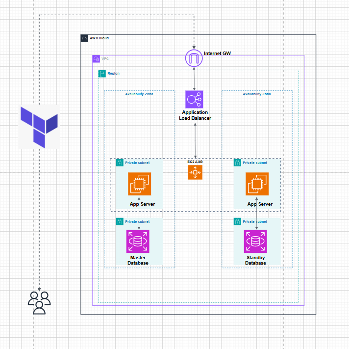
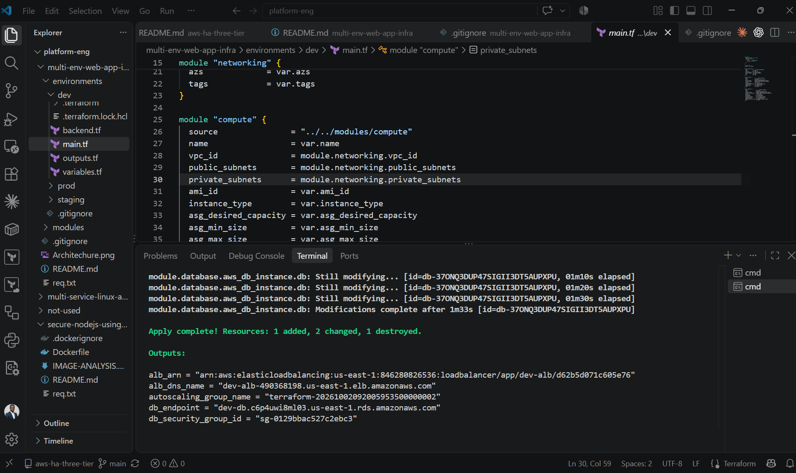
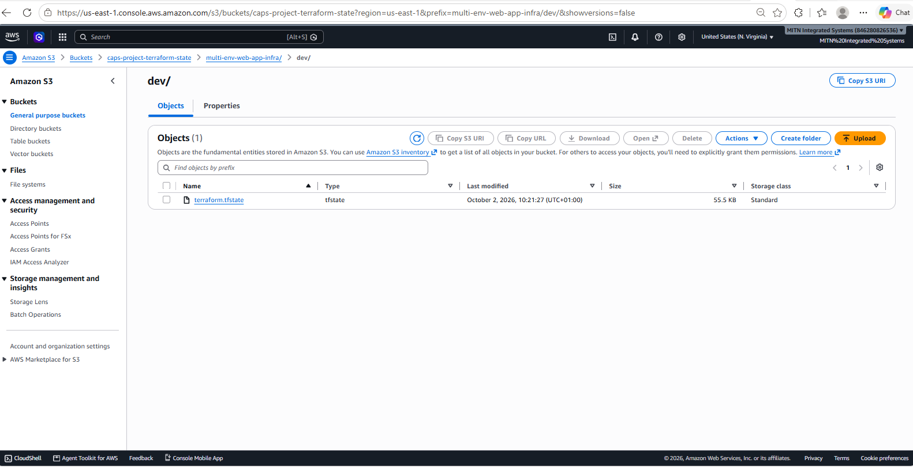
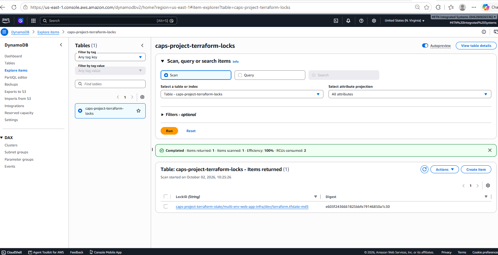
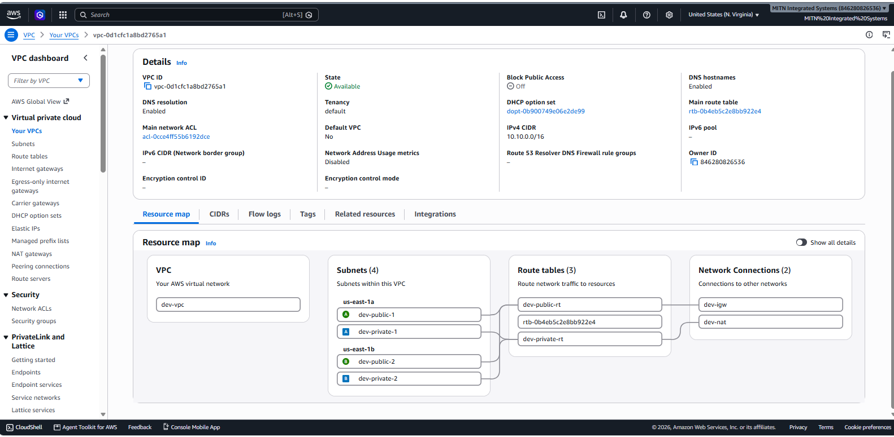

# Multi-Environment Web App Infrastructure

Terraform infrastructure for deploying a multi-environment web application platform on AWS.

The project uses reusable Terraform modules for networking, compute, and database infrastructure. Separate environment configurations are provided for **development, staging, and production**, allowing each environment to use the same infrastructure architecture with different capacity and configuration settings.

The platform separates internet-facing resources from application and database resources using public and private VPC subnets.

## Architecture



## Project Structure

```text
multi-env-web-app-infra/
├── environments/
│   ├── dev/
│   ├── staging/
│   └── prod/
├── modules/
│   ├── networking/
│   ├── compute/
│   └── database/
├── .gitignore
└── README.md
```

## Modules

* **Networking:** VPC, public/private subnets, Internet Gateway, NAT Gateway, route tables.
* **Compute:** ALB, target group, listener, security group, launch template, Auto Scaling Group.
* **Database:** RDS MySQL, DB subnet group, and security group.

Each environment uses the same modules with environment-specific configuration.

## Backend Setup

Terraform state uses **Amazon S3**, with **DynamoDB** for state locking.

Create the backend resources in `us-east-1`:

```cmd
aws s3api create-bucket --bucket caps-project-terraform-state --region us-east-1
```

```cmd
aws dynamodb create-table --table-name caps-project-terraform-locks --attribute-definitions AttributeName=LockID,AttributeType=S --key-schema AttributeName=LockID,KeyType=HASH --billing-mode PAY_PER_REQUEST --region us-east-1
```

If the S3 bucket name is unavailable, use a globally unique name and update `backend.tf`.

## AWS Authentication

Verify the active AWS account:

```cmd
aws sts get-caller-identity
```

Verify the region:

```cmd
aws configure get region
```

## Deployment

From the required environment:

```cmd
cd environments\dev
```

Initialize and validate:

```cmd
terraform init
terraform fmt -check -recursive
terraform validate
```

### Dev

The current development configuration uses `t3.micro`:

```cmd
terraform plan -var="ami_id=ami-0d27e0fb3bac4d724" -var="instance_type=t3.micro" -var="db_username=admin" -var="db_password=YOUR_PASSWORD"
```

Apply:

```cmd
terraform apply -var="ami_id=ami-0d27e0fb3bac4d724" -var="instance_type=t3.micro" -var="db_username=admin" -var="db_password=YOUR_PASSWORD"
```

Replace the AMI ID with an AMI compatible with the selected AWS region and architecture.

Check currently eligible Free Tier instance types with:

```cmd
aws ec2 describe-instance-types --filters Name=free-tier-eligible,Values=true --query "InstanceTypes[].InstanceType" --output text --region us-east-1
```

The Terraform variable is **`instance_type`**, not `app_instance_type`.

## Staging / Production

Run the same workflow from:

```text
environments\staging
environments\prod
```

Use the appropriate AMI, instance type, database credentials, and environment-specific configuration.

Production is configured for larger application capacity and **7-day database backups**.

## Security

Do not commit credentials or sensitive Terraform files.

The `.gitignore` excludes:

```text
.terraform/
*.tfstate
*.tfstate.*
*.tfvars
*.tfvars.json
.env
*.pem
*.key
```

Use secure secret-management practices for production credentials.

## Validation

Before applying changes:

```cmd
terraform fmt -check -recursive
terraform validate
terraform plan
```

After deployment, verify the infrastructure is stable:

```cmd
terraform plan
```

Expected result:

```text
No changes. Your infrastructure matches the configuration.
```

## Cleanup

To remove an environment:

```cmd
terraform destroy -var="ami_id=YOUR_AMI_ID" -var="instance_type=YOUR_INSTANCE_TYPE" -var="db_username=admin" -var="db_password=YOUR_PASSWORD"
```

Review the destruction plan carefully before confirming.


## EVIDENCES
# TERRAFORM


# BACKEND


# STATE-LOCKING


# VPC

